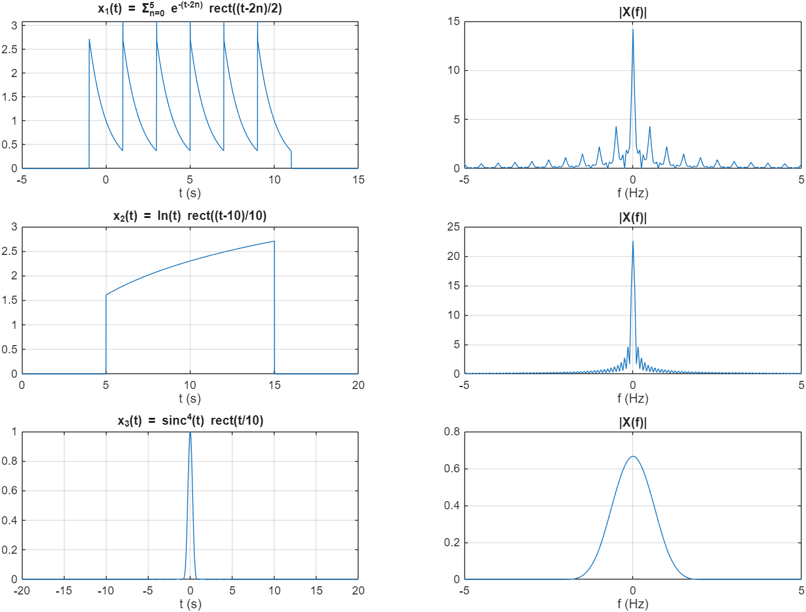
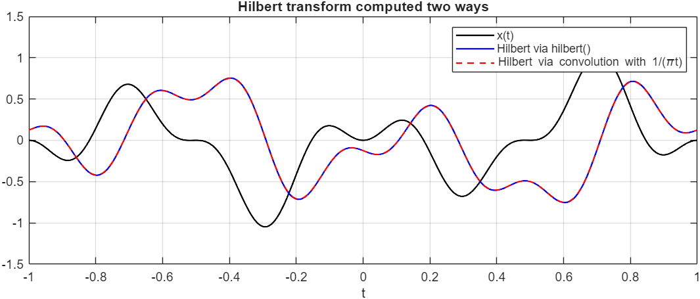
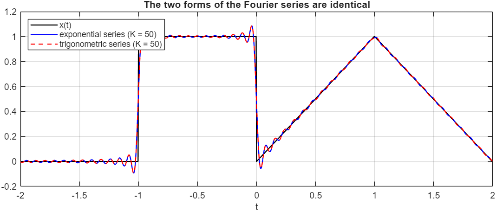

# Communication Systems in MATLAB, Homework 1: Fourier Transforms, FFT and the Hilbert Transform

> **Course:** Communication Systems I, Amirkabir University of Technology, 2024. Run `main` in MATLAB; figures go to `results/`.

## Q1. Spectra of three signals with the FFT
The continuous-time transform is approximated as $X(f_k)\approx \Delta t\sum_n x(t_n)e^{-j2\pi f_kt_n}$. That means `fftshift(fft(x))*dt` on the frequency grid $f_k = k/(N\Delta t)$. With this scaling, **Parseval's theorem holds to 4 decimals** for all three signals:
- **x₁(t):** six truncated exponentials.
- **x₂(t):** ln t windowed to 5 ≤ t ≤ 15.
- **x₃(t):** sinc⁴(t). Its transform is the compactly supported Λ ∗ Λ (|f| ≤ 2).

## Q2. Direct DFT vs. FFT
For N = 2000, the direct O(N²) sum takes 65 ms and the FFT 0.3 ms, about **200× faster**. The results agree to 10⁻¹².

## Q3. Hilbert transform two ways
- **`hilbert()`:** FFT-based. It is exact here, because x(t) = sin³(πt)cos²(πt) + sin²(2πt)cos(3πt) is periodic.
- **Convolution with 1/(πt):** computed as a principal value with the periodised kernel 1/(2 tan(πτ/2)), skipping the singular point.

The two agree to 3 × 10⁻³. The inner product ⟨x, x̂⟩ = 10⁻¹⁷ confirms that a signal and its Hilbert transform are **orthogonal**.

## Q4. Exponential vs. trigonometric Fourier series
With 50 harmonics, both series reconstruct the period-4 waveform. The two forms are identical to machine precision, because $c_n = (a_n - jb_n)/2$.

## Changes compared with the original submission
- **Frequency axes.** The original used `(-N/2:N/2-(fs/N))*fs/N` with an arbitrary `/100` amplitude scaling. They are now proper axes with `dt` scaling, and Parseval verifies them.
- **Q2 kernel.** The direct DFT used $e^{-jft}$ without the 2π, so it did not compute the same transform as the FFT.
- **Q3 plot and kernel.** The "convolution" subplot re-plotted the `hilbert()` result. The 1/(πt) kernel was also sampled at t = 0, where it is infinite.

**Sepehr Ebrahimi**, B.Sc. Electrical Engineering, Amirkabir University of Technology (2026)
